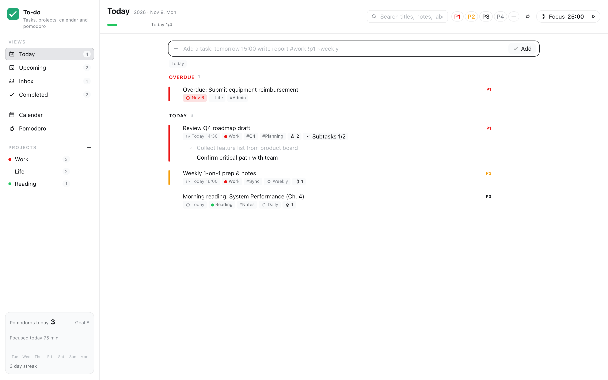
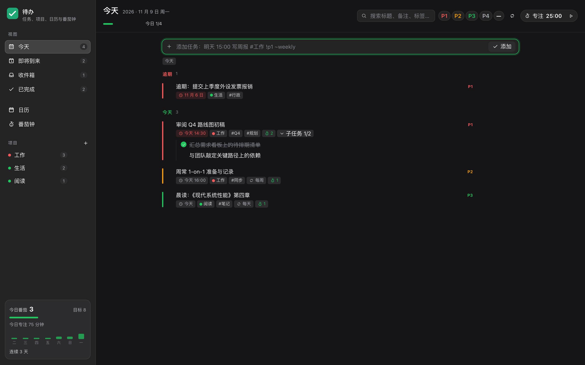
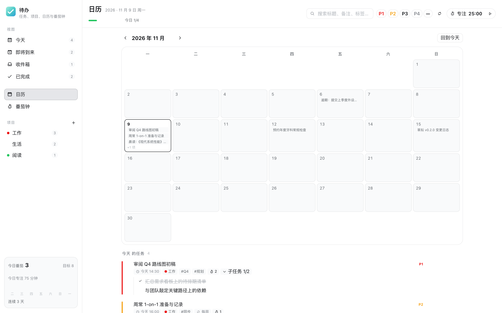
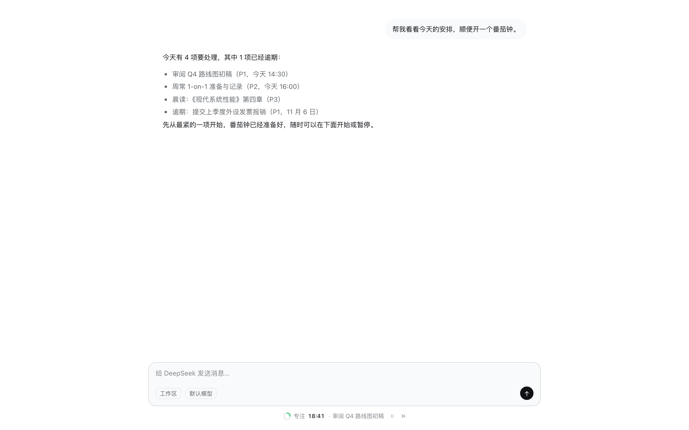
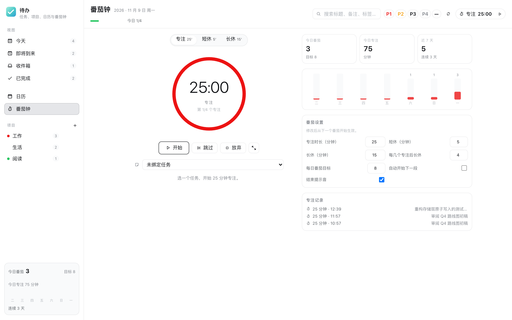
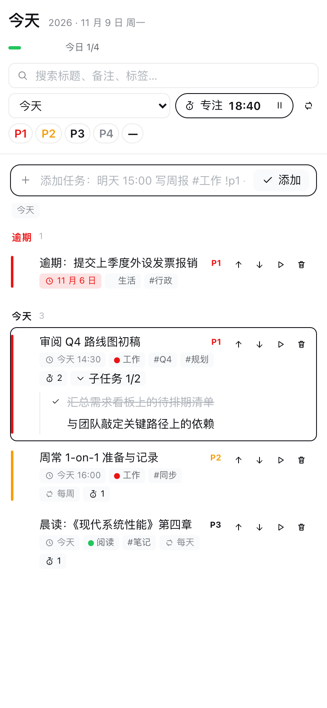

[中文](./README.zh-CN.md) | **English**

# dsh-todo

A full-featured to-do list and Pomodoro timer plugin for DeepSeek Harness. Combines the core workflow of **Todoist** (Today, Upcoming, Inbox, Projects, Priorities, Natural-Language Quick Add) with the focused timeboxing of **TickTick** (Pomodoro timer bound to tasks, 25/5/15 cycles, and 7-day stats).

Runs entirely local: tasks, projects, settings, and Pomodoro sessions are saved to `$DSH_HOME/storages/todo/state.json` via atomic file writes. DeepSeek Harness agents can read and write the exact same task database via the built-in `todo` tool.

---

## Screenshots

### Today View (Light & Dark)




### Calendar View


### Always-visible timer in the conversation
The timer lives under the composer, so it stays in view while you chat: countdown, bound task, pause and skip without leaving the conversation.



### Pomodoro Timer & 7-Day Stats


### Mobile & Responsive Layout


---

## Features

### Task Management
- **Views**: Today (split into Overdue and Today), Upcoming (grouped by date), Inbox, Completed, Projects, Calendar, and Pomodoro.
- **Natural-Language Quick Add**: Type `Tomorrow 3pm review roadmap #work !p1 ~weekly` to parse due dates, times, projects, priorities, and recurrence rules into structured fields automatically.
- **Task Hierarchy**: One-level subtasks with progress tracking (`1/2 completed`), cascade completion, and cascade deletion with full undo support.
- **Recurring Tasks**: Supports `daily`, `weekday` (skipping weekends), `weekly`, and `monthly` frequencies with catch-up logic. Marking a recurring task complete archives the current occurrence and immediately spawns the next scheduled occurrence with fresh subtasks.
- **Priorities & Labels**: P1 (Urgent, red), P2 (High, orange), P3 (Medium, blue), P4 (Low, gray), plus arbitrary `#project` and `@tag` labels.
- **Calendar Grid**: Interactive monthly grid displaying task count dots; clicking any date filters tasks for that specific day.
- **Search & Filter**: Real-time keyword search across titles and notes, combined with multi-select priority filters.

### Pomodoro Timer
- **Work Cycles**: 25-minute focus, 5-minute short break, 15-minute long break every 4 focus sessions (all durations and cycle counts configurable).
- **Task Binding**: Bind the active timer to any task; completing a focus session increments that task's Pomodoro counter.
- **Composer dock**: A compact timer row sits under chat composer in every session — idle shows the configured focus length, running shows the countdown with the bound task and pause/skip controls. The sidebar icon shows a pulsing dot while a session runs.
- **Persistent Countdown**: Timer state is preserved in browser storage (`localStorage`) with absolute timestamps, surviving page refreshes without drifting.
- **Audio & Visual Alerts**: Synthetic Web Audio chime and optional browser notification when a session ends.
- **Statistics**: Today's Pomodoros vs daily goal, focus minutes, cumulative totals, current streak (in days), and a 7-day bar chart.

### Agent Tool (`todo`)
Autonomous agents can inspect, organize, and update your task database using the registered `todo` tool:

```json
{
  "action": "list",
  "view": "today"
}
```

Supported actions:
- `list`: Filter by view (`today`, `upcoming`, `inbox`, `completed`, `all`), project, or search query.
- `add`: Create tasks with title, due date/time, priority, project, and recurrence.
- `update`: Modify title, note, due date, priority, or project.
- `complete`: Toggle task completion and generate recurring occurrences.
- `delete`: Remove tasks and their child subtasks.
- `stats`: Retrieve today's completed task count, focus minutes, and Pomodoro counts.
- `project`: Create a new project.

---

## Installation

Inside DeepSeek Harness, open the Plugin Manager and install from local directory:

```bash
/path/to/dsh-plugins/dsh-todo
```

Or clone into your local plugin folder and mount via `cordis.patch.yml`:

```yaml
- insert:
    - id: todo
      name: dsh-todo
```

Refresh the DeepSeek Harness Web GUI to see the **Todo** entry in the left sidebar.

---

## Development & Testing

Run the full test suite (117 unit and integration tests across storage, recurrence rules, HTTP routes, agent tool, natural language parsing, Pomodoro state machine, and bilingual dictionaries):

```bash
npm test
```

Start the standalone local preview server:

```bash
npm run preview
```

Generate fresh headless Chrome screenshots:

```bash
npm run screenshot
```

---

## License

[MIT](./LICENSE) © 2026 polunzh
