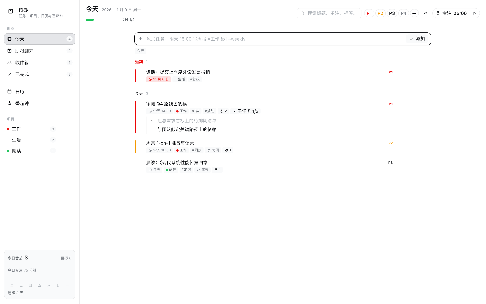
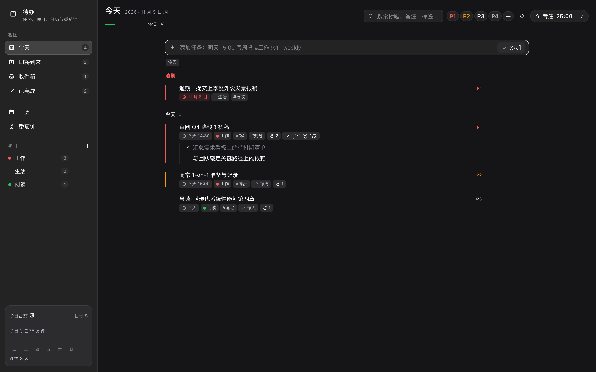
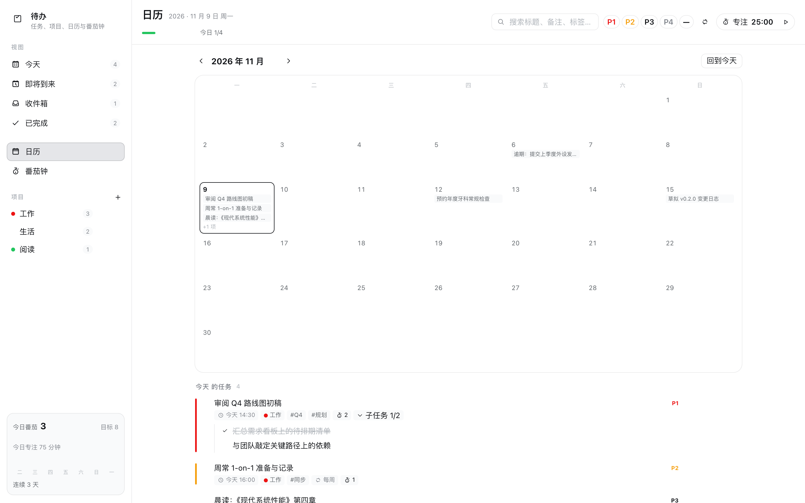
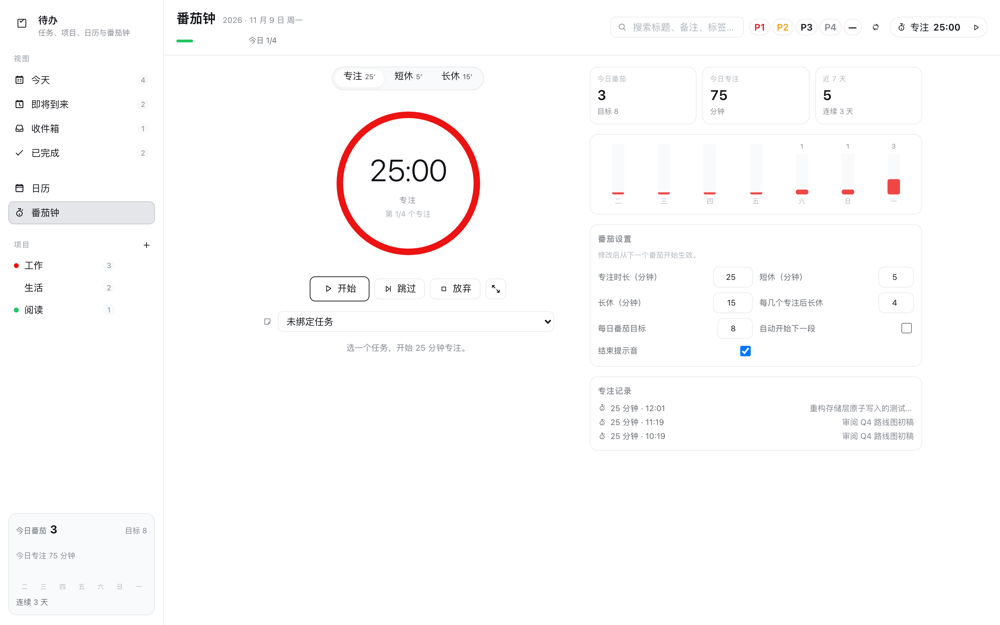
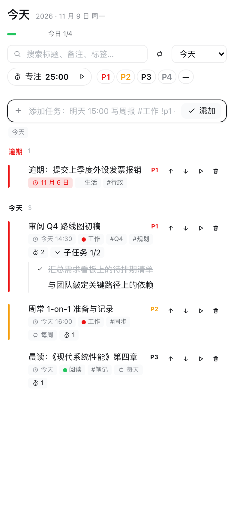

**中文** | [English](./README.md)

# dsh-todo

DeepSeek Harness 待办清单与番茄钟插件。深度融合 **Todoist** 经典的任务结构（今天、即将到来、收件箱、项目分类、四级优先级、自然语言快速添加）与 **TickTick** 的专注体验（任务绑定番茄钟、25/5/15 循环、7 天柱状图统计）。

全部数据保存在本机 `$DSH_HOME/storages/todo/state.json`，通过临时文件加原子重命名（0o600 权限）落盘。智能体可通过内置的 `todo` 工具与用户读写同一份待办数据。

---

## 界面预览

### 今天视图（亮色与暗色）




### 日历视图


### 番茄钟与 7 天统计


### 窄屏响应式适配


---

## 功能特性

### 任务管理
- **七大视图**：今天（细分逾期与今天）、即将到来（按日期分组）、收件箱（无日期待归档）、已完成（归档并支持恢复）、项目视图、月度日历网格以及专注番茄钟。
- **自然语言快速添加**：输入 `明天 15:00 写周报 #工作 !p1 ~weekly` 即可自动解析出截止日期、具体时刻、所属项目、优先级以及重复周期；无法识别的部分原样保留为标题。
- **子任务支持**：单层子任务树形展示，显示完成进度（如 `1/2`），支持级联完成、重置与级联删除，附带全局撤销机制。
- **周期重复任务**：支持每天（`daily`）、工作日（`weekday`，跳过周末）、每周（`weekly`）与每月（`monthly`，月末平移保护）。完成重复任务时，旧记录归档，系统自动按规则生成下一次待办并复制子任务模板。
- **四级优先级与标签**：P1（紧急红）、P2（重要橙）、P3（次要蓝）、P4（普通灰），支持自定义项目色彩圆点与多标签体系。
- **月历网格**：直观的月度网格日历，日期下方标注任务圆点，点击任一日即可在侧栏快速筛选当天任务。
- **搜索与筛选**：支持标题及备注的实时关键词检索，配合优先级多选快速聚焦。

### 番茄时钟
- **经典循环**：25 分钟专注、5 分钟短休、每完成 4 个专注触发 15 分钟长休（各项时长与周期均可在设置中调整）。
- **任务深度绑定**：可将计时器绑定到指定待办；每次专注结束后自动为该任务增加 1 个番茄累计。
- **持久化防丢倒计时**：基于 `localStorage` 与绝对时间戳维护状态，浏览器刷新或标签页关闭重新打开依然保持准确倒计时。
- **轻量提醒**：内置 Web Audio 合成清脆提示音，支持浏览器系统弹窗通知。
- **专注数据分析**：展示今日番茄数、今日专注分钟、连续打卡天数及近 7 天每日专注时长的柱状图对比。

### 智能体工具（`todo`）
智能体可直接调用 `todo` 工具协助用户规划、录入并追踪每日事项：

```json
{
  "action": "add",
  "title": "梳理项目交付清单",
  "priority": 1,
  "due": "2026-11-09 16:00",
  "project": "工作"
}
```

支持动作：
- `list`：按视图（`today`、`upcoming`、`inbox`、`completed`、`all`）、项目名称或关键词查询任务。
- `add`：录入新任务，支持传入截止时间、优先级、项目和重复规则。
- `update`：修改任务标题、备注、时间、优先级等属性。
- `complete`：标记任务完成（如果是重复任务会自动生成下一次待办）。
- `delete`：安全删除任务及其下属子任务。
- `stats`：统计今日完成任务数、专注时长及番茄数。
- `project`：快速建立新项目分类。

---

## 安装说明

在 DeepSeek Harness 插件管理器中，选择从本地目录安装：

```bash
/path/to/dsh-plugins/dsh-todo
```

或将本目录放置在你的本地插件库中，通过 `cordis.patch.yml` 引入：

```yaml
- insert:
    - id: todo
      name: dsh-todo
```

刷新 DeepSeek Harness 界面，侧边栏左侧即可看到「待办」入口。

---

## 本地开发与测试

运行完整的 117 项单元与集成测试（涵盖本地存储、递归规则、路由接口、智能体工具、自然语言解析、番茄状态机与中英文字典）：

```bash
npm test
```

启动零外部依赖的独立本地预览页：

```bash
npm run preview
```

重新生成无界面干扰的真实 Chrome 截图：

```bash
npm run screenshot
```

---

## 开源协议

[MIT](./LICENSE) © 2026 polunzh
