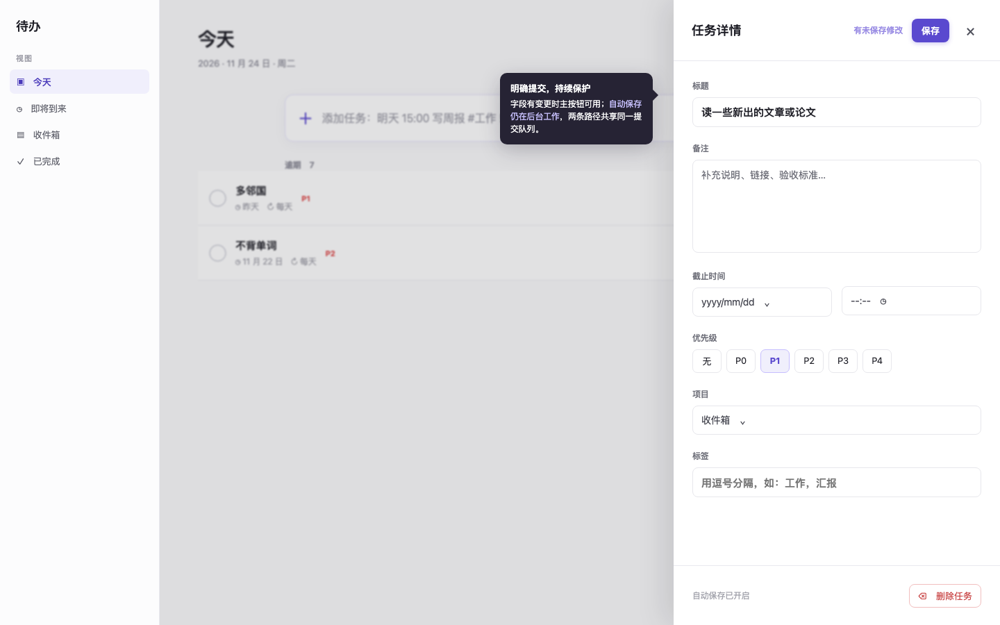

# 详情抽屉的显式保存

## 目标

在保持自动保存的前提下，为任务详情抽屉增加一个清晰、可预期的显式保存入口。用户可以在连续编辑后主动确认一次提交；自动保存仍持续保护输入内容。

## 交互与布局

- 顶栏从左到右为「任务详情」、紧凑保存状态、紫色主按钮「保存」、关闭按钮。保存按钮是唯一的新入口，不在页脚或字段旁复制操作。
- 任一字段发生本地修改后，状态变为「有未保存修改」，保存按钮启用并显示「保存」；自动保存计时在后台继续工作。
- 自动保存请求进行时，按钮显示「保存中…」并禁用；成功后恢复「已保存」状态。用户点击「保存」会立即提交当前编辑值，并让状态即时恢复为「已保存」。
- 自动保存失败时，状态和按钮转为可见的错误色并显示「重试保存」；点击后按同一路径重新提交，抽屉不关闭，输入不丢失。 
- 详情底部的「修改会自动保存」提示调整为「自动保存已开启」，说明保障机制而不与主按钮竞争。

## 范围与边界

- 仅修改 `lib/client.js` 中的 `TaskDetail`、抽屉样式与中英文文案；任务 API、存储结构、路由和列表行为保持不变。
- 保存按钮调用现有字段更新路径，保证手动保存和自动保存序列化，避免旧请求覆盖较新的编辑值。
- 键盘支持：`⌘/Ctrl + Enter` 触发保存；按钮具有清晰的 `aria-label`、禁用语义和状态播报。
- 在 400px 抽屉和窄屏下保留图标加「保存」文字；空间不足时保存状态优先缩短为图标提示，关闭按钮始终可用。

## 关键状态

1. 初始 / 已保存：状态「已保存」，按钮禁用。
2. 编辑中：状态「有未保存修改」，按钮可点击。
3. 提交中：状态「保存中…」，按钮禁用，避免并发请求。
4. 失败：状态「保存失败」，按钮显示「重试保存」，保留当前输入。

## 高保真稿

亮色桌面抽屉稿展示「有未保存修改」状态与主操作位置：

