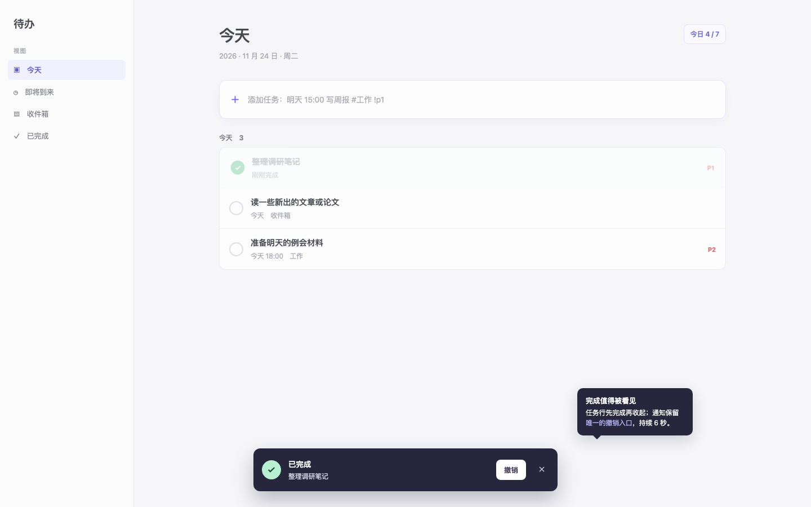

# 任务完成反馈强化

> 更新：0.2.24 起任务完成音效与番茄结束提示音是两个独立开关，见 [design-todo-complete-sound.md](./design-todo-complete-sound.md)。

## 目标

任务完成后，用户应立刻感到一项工作已被清晰地记录，而不是只看见列表中的任务消失。完成反馈也需要提供可靠、容易点击的撤销机会。

## 交互与布局

- 勾选任务后，任务行先以完成态保留约 220ms，再从当前位置收起，让因果关系保持连续；完成记录写入后再更新列表和今日进度。
- 页面底部中央显示完成专用提示条：左侧为实心对勾圆标，中间两行显示「已完成」与任务标题，右侧只有一个强调操作「撤销」。提示条使用深靛背景、白字和绿色对勾，确保在亮暗主题中都有足够对比。
- 完成提示持续 6 秒；鼠标悬停、键盘聚焦或屏幕阅读器浏览时暂停倒计时。撤销会恢复任务到原视图并关闭提示。
- 重复任务补充「下一次：日期」作为第二行信息；普通任务第二行展示任务标题。错误提示、删除提示与番茄钟提示维持现有中性样式，避免所有通知抢同一视觉层级。
- 完成写入成功的同一用户手势中，播放一个短促、上行的双音确认音（约 220ms）；声音与完成提示同时出现，形成一次明确的结束感。失败、撤销、自动保存和普通提示不播放声音。
- 现有声音设置改名为唯一的「提示音」，说明为「任务完成和番茄钟结束时播放」，并保持一个「试听」按钮。新用户默认开启；已有用户已保存的开关值保持不变。一个入口统一管理所有正向完成反馈。
- 窄屏时提示条铺满安全边距；任务标题限制为两行，撤销始终保持同一处入口。

## 范围与边界

- 只升级完成任务的 toast 渲染、完成过渡和撤销动作；任务存储、完成语义、项目统计和其他提示条保持不变。
- 复用现有 `toggleTask(task, false)` 恢复任务，避免引入第二套撤销状态或新的 API。
- 使用 `role="status"` 宣读完成结果；「撤销」为原生按钮，键盘焦点始终可见。
- 提示音使用浏览器 Web Audio API 的振荡器与渐弱包络生成，不引入音频资源或第三方依赖；勾选任务时先在用户手势内唤醒音频上下文，写入成功后播放任务完成双音；番茄钟沿用原有三音版本；浏览器静音和系统音量仍始终优先。

## 高保真稿

